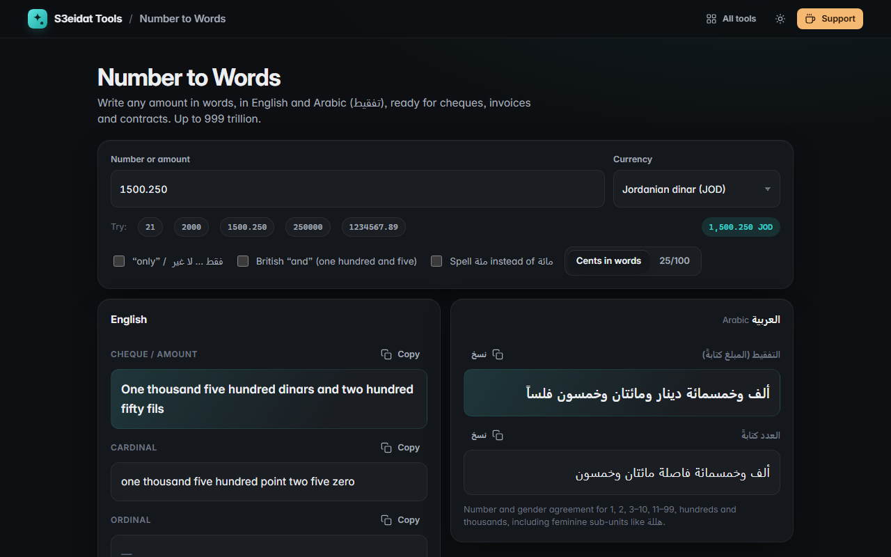

# Number to Words

> Write numbers as words in English and Arabic (تفقيط), with currency. Free, private, and it runs entirely in your browser.

### ▶ [Open Number to Words](https://s3eidat.github.io/number-words/)



## Features

- **English**: cardinal (`one thousand five hundred point two five`), ordinal (`twenty-first · 21st`) and cheque style
  (`One thousand five hundred dollars and twenty-five cents`, or `… and 25/100 dollars`), optional British "and" and "only"
- **Arabic tafqeet** with currency: `ألف وخمسمائة دينار ومائتان وخمسون فلساً`, optional `فقط … لا غير`, and the مئة / مائة spelling of your choice
- **Currencies**: Jordanian dinar / fils (1,000), Kuwaiti dinar / fils (1,000), US dollar / cent, Saudi riyal / halala,
  UAE dirham / fils, Egyptian pound / piastre, British pound / penny, or none
- Amounts are **rounded half-up** to the currency's sub-unit (3 decimals for dinars, 2 for the rest)
- Accepts `1,500.250`, `1500.25`, negative numbers (plain words only) and Arabic-Indic digits (`١٥٠٠٫٢٥`)
- Up to **999 trillion**; exact integer maths (BigInt), so large numbers never lose digits

### Arabic grammar handled

| Amount | Output |
|---|---|
| 1 | دينار واحد |
| 2 | ديناران |
| 3–10 | ثلاثة دنانير (number takes the opposite gender) |
| 11–99 | أحد عشر ديناراً، واحد وعشرون ديناراً (singular, accusative) |
| 100, 1000 | مائة دينار، ألف دينار |
| 200, 2000 | مائتا دينار، ألفا دينار (dual in construct before the noun) |
| 3000, 11000, 150000 | ثلاثة آلاف، أحد عشر ألفاً، مائة وخمسون ألفاً |
| feminine units | ثلاث هللات، إحدى عشرة هللة، هللة واحدة |

Amounts such as 101 are written the way cheques usually do (`مائة وواحد دينار`). The built-in self-test checks all of the
cases above plus English ordinals, cheque wording, rounding and input parsing.

## Privacy

Everything runs on your device. Only your option choices (currency, toggles) are kept in this browser's local storage, never
the numbers you type. There is no server, no account, no analytics. The page ships with a strict Content-Security-Policy
(`connect-src 'self'`), so the browser itself blocks any attempt to send data anywhere.

## Run it yourself

It's plain HTML, CSS and JavaScript with no build step:

```bash
git clone https://github.com/s3eidat/number-words
cd number-words
python -m http.server 8000
```

Then open http://localhost:8000.

## Support

If this saved you time, **[buy me a coffee ☕](https://s3eidat.github.io/coffee/)**. It keeps every tool free.

---

Part of **[S3eidat Tools](https://s3eidat.github.io/)**: 100+ free, private tools that run in your browser. MIT licensed.
